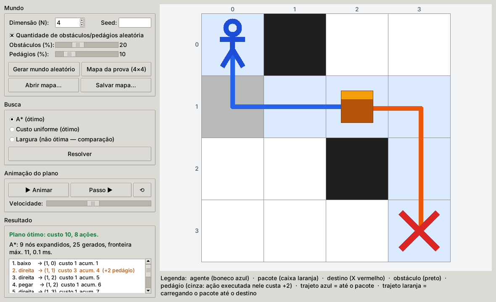
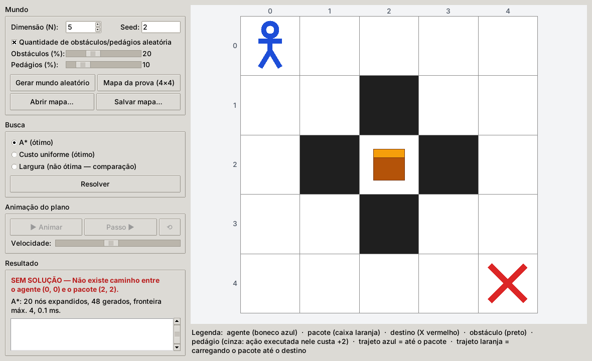
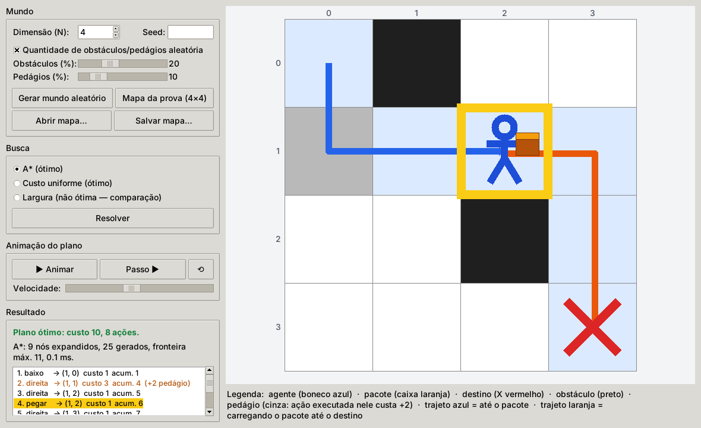
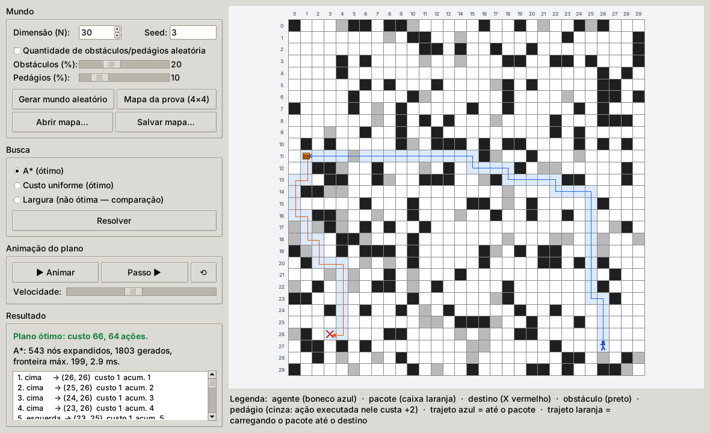

# Entregador em Grid — APS de Revisão da Prova

**Disciplina:** Inteligência Artificial e Robótica — Insper
**Aluno:** Eduardo Khaled Chmouri Guardiano
**Trabalho:** APS "Exercício de Revisão da Prova" — implementação do problema da primeira parte da avaliação intermediária

> Um agente em um mundo em grid quadrado, com obstáculos e células de pedágio, precisa **pegar um pacote e entregá-lo na célula de destino com o menor custo possível**. O programa gera mundos aleatórios de qualquer dimensão, encontra o **plano ótimo** (ou informa que **não existe solução**) e mostra tudo em uma interface gráfica.



---

## Sumário

1. [O problema](#1-o-problema)
2. [Como executar](#2-como-executar)
3. [Estrutura do repositório](#3-estrutura-do-repositório)
4. [Modelagem](#4-modelagem)
   - 4.1 [Representação do estado](#41-representação-do-estado-questão-2)
   - 4.2 [Geração de sucessores](#42-geração-de-sucessores-questão-3)
   - 4.3 [Função de custo](#43-função-de-custo)
   - 4.4 [Teste de meta](#44-teste-de-meta)
   - 4.5 [Heurística](#45-heurística-questão-6)
   - 4.6 [Algoritmos de busca](#46-algoritmos-de-busca-questão-5)
5. [Detecção de "sem solução"](#5-detecção-de-sem-solução)
6. [Interface gráfica](#6-interface-gráfica)
7. [Exemplos de execução](#7-exemplos-de-execução)
8. [Experimentos e verificação](#8-experimentos-e-verificação)
9. [Decisões de interpretação do enunciado](#9-decisões-de-interpretação-do-enunciado)
10. [Relação com a biblioteca do curso (aigyminsper)](#10-relação-com-a-biblioteca-do-curso-aigyminsper)
11. [Testes automatizados](#11-testes-automatizados)
12. [Relação com as questões da prova](#12-relação-com-as-questões-da-prova)

---

## 1. O problema

Enunciado da prova (resumido):

- O mundo é um **grid quadrado N×N**, com N definido pelo usuário.
- Células **pretas** são **obstáculos** (intransponíveis). Células **cinzas** são **pedágios**.
- Há **um agente**, **um pacote** e **um destino** (X). A cada inicialização, as posições de todos e a quantidade/posição de obstáculos e pedágios podem mudar (sorteio aleatório).
- O agente sabe executar **6 ações**: `cima`, `baixo`, `esquerda`, `direita`, `pegar` e `entregar`.
  - Um movimento leva o agente para a célula vizinha; se ela está fora do grid ou é obstáculo, o agente **fica onde está**.
  - O pacote só se move quando está com o agente. `entregar` deixa o pacote na célula onde o agente executou a ação.
- **Objetivo:** um plano **ótimo** (sequência de ações) que leve o pacote até o destino. O estado final é "o pacote está na célula de destino".
- **Custo:** todas as ações custam o mesmo (1). Porém, quando o agente executa **qualquer ação em uma célula de pedágio**, o custo real é `custo = custo + 2` (ou seja, 3).

Requisitos adicionais da APS: funcionar para **qualquer dimensão** quadrada; **interface gráfica** em que o usuário define a dimensão; posições iniciais e obstáculos **aleatórios**; e a implementação deve **dizer quando não existe solução**.

## 2. Como executar

Requisitos: **Python 3.10+** com `tkinter` (vem com o Python no Windows/macOS; no Linux, `sudo apt install python3-tk`). O programa principal **não depende de nenhuma biblioteca externa**.

```bash
# Interface gráfica
python main.py

# Linha de comando
python -m entregador.cli --prova                        # mapa da Figura 2 da prova (custo 10)
python -m entregador.cli --n 10 --seed 42               # mundo aleatório 10x10 reprodutível
python -m entregador.cli --n 8 --passos                 # mostra o grid após cada ação
python -m entregador.cli --mapa exemplos/mapas/exemplo_10x10.txt --algoritmo todos
python -m entregador.cli --n 12 --obstaculos 0.25 --pedagios 0.1 --salvar meu_mapa.txt
python -m entregador.cli --help
```

Código de saída da CLI: `0` quando encontra solução, `1` quando o mundo não tem solução, `2` para argumentos ou arquivos inválidos.

Opcional (para os testes e para a comparação com a biblioteca do curso):

```bash
pip install -r requirements.txt      # aigyminsper==0.3.9 e pytest
python -m pytest -q                  # 75 testes
python exemplos/comparar_algoritmos.py
python exemplos/comparar_biblioteca.py
```

## 3. Estrutura do repositório

```
.
├── main.py                        # abre a interface gráfica
├── entregador/
│   ├── mundo.py                   # Mundo: grid, obstáculos, pedágios, posições; geração aleatória; mapa em texto
│   ├── estado.py                  # EstadoEntrega: representação do estado, sucessores, custo, meta, heurística
│   ├── busca.py                   # A*, custo uniforme, largura (comparação); diagnóstico de "sem solução"
│   ├── compat_aigyminsper.py      # A*/custo uniforme como SearchAlgorithm da biblioteca do curso (opcional)
│   ├── gui.py                     # interface gráfica (tkinter)
│   └── cli.py                     # execução pelo terminal
├── tests/                         # suíte pytest (75 testes)
├── exemplos/
│   ├── mapas/                     # mapas fixos (prova, contraexemplos, sem solução, 10x10, 20x20)
│   ├── saidas/                    # saídas gravadas das execuções
│   ├── imagens/                   # capturas de tela da interface
│   ├── exemplo_aigyminsper.py     # main() no formato do guia da aigyminsper (search + show_path)
│   ├── comparar_algoritmos.py     # A* vs custo uniforme vs largura em centenas de mundos
│   └── comparar_biblioteca.py     # nosso estado rodando nos algoritmos da aigyminsper
├── requirements.txt
└── README.md
```

## 4. Modelagem

Convenção: posições são pares `(linha, coluna)` **0-indexados**; `(0, 0)` é o canto superior esquerdo.

### 4.1 Representação do estado (Questão 2)

**Princípio:** o estado contém **somente o que muda** ao longo do plano. O que é fixo (dimensão, obstáculos, pedágios, destino) fica em um objeto `Mundo` imutável, compartilhado por todos os estados.

| Campo    | Tipo                     | Significado                                                                 |
|----------|--------------------------|------------------------------------------------------------------------------|
| `agente` | `(linha, coluna)`        | célula em que o agente está                                                  |
| `pacote` | `(linha, coluna)` ou `None` | célula em que o pacote está **no chão**; `None` quando o agente o está **carregando** |

Isso dá a tupla `(agente, pacote)`; o espaço de estados tem no máximo `N² · (N² + 1)` estados, o que é pequeno mesmo para grids grandes (e o A* explora uma fração ínfima disso — ver §8).

Exemplos para a Figura 2 da prova (4×4):

```
estado inicial : agente=(0, 0), pacote=(1, 2)     # pacote no chão na célula sorteada
estado final   : agente=(3, 3), pacote=(3, 3)     # pacote no chão no destino (3, 3)
```

Por que o estado precisa do pacote? Porque "agente em (1, 2)" são **duas situações diferentes** dependendo de o pacote já ter sido pego ou não — sem essa informação o algoritmo não sabe quando `pegar`/`entregar` fazem sentido nem quando a meta foi atingida.

O construtor (método `__init__`) e a interface completa estão em [`entregador/estado.py`](entregador/estado.py):

```python
class EstadoEntrega(HeuristicState):
    def __init__(self, operador, mundo, agente, pacote, custo_acao=0):
        super().__init__(operador)   # nome da ação que gerou o estado ("" no inicial)
        self.mundo = mundo           # ambiente fixo (grid, obstáculos, pedágios, destino)
        self.agente = agente         # (linha, coluna)
        self.pacote = pacote         # (linha, coluna) no chão, ou None se carregado
        self.custo_acao = custo_acao # custo da ação que gerou o estado (1 ou 3)

    @classmethod
    def inicial(cls, mundo):
        return cls("", mundo, mundo.agente, mundo.pacote, 0)
```

### 4.2 Geração de sucessores (Questão 3)

`successors()` aplica as seis ações e devolve a lista dos estados resultantes (cada um com o nome da ação em `operator` e o custo da ação em `cost()`):

| Ação                                   | Pré-condição                                             | Efeito                                                     |
|----------------------------------------|----------------------------------------------------------|------------------------------------------------------------|
| `cima`/`baixo`/`esquerda`/`direita`    | célula vizinha dentro do grid e **não** obstáculo        | agente vai para a vizinha; se carrega o pacote, ele vai junto |
| `pegar`                                | agente na célula do pacote e pacote no chão              | `pacote = None` (carregado)                                |
| `entregar`                             | agente carregando o pacote                               | `pacote = célula atual do agente`                          |

Movimentos bloqueados (borda/obstáculo) deixariam o agente parado: eles **não geram sucessor**, porque custariam ≥ 1 sem mudar o estado e, portanto, nunca fazem parte de um plano ótimo. Isso é apenas uma poda óbvia — não altera a solução.

```python
def successors(self):
    custo = self.mundo.custo_acao_em(self.agente)        # 1, ou 3 se o agente está em pedágio
    sucessores = []
    linha, coluna = self.agente
    for nome, (dl, dc) in MOVIMENTOS.items():             # cima, baixo, esquerda, direita
        nova = (linha + dl, coluna + dc)
        if self.mundo.transitavel(nova):                  # dentro do grid e não obstáculo
            sucessores.append(EstadoEntrega(nome, self.mundo, nova, self.pacote, custo))
    if self.pacote is not None and self.agente == self.pacote:
        sucessores.append(EstadoEntrega("pegar", self.mundo, self.agente, None, custo))
    if self.pacote is None:
        sucessores.append(EstadoEntrega("entregar", self.mundo, self.agente, self.agente, custo))
    return sucessores
```

### 4.3 Função de custo

`cost()` devolve o custo da ação que **gerou** o estado (convenção da `aigyminsper`: `Node.g = pai.g + estado.cost()`):

- **1** para qualquer ação;
- **3** (`1 + 2`) se a ação foi executada **estando** em uma célula de pedágio.

A célula que conta é a célula em que o agente **estava** quando executou a ação — leitura literal de "executar qualquer ação **em** uma célula marcada em cinza". Ver §9 para a discussão.

### 4.4 Teste de meta

`is_goal()` é verdadeiro quando `pacote == destino`, isto é, o pacote está **no chão** na célula de destino — exatamente a definição do enunciado ("o estado final é quando o pacote está na célula de destino"). Passar pelo destino carregando o pacote **não** é meta: é preciso executar `entregar`.

### 4.5 Heurística (Questão 6)

Seja `d(a, b)` a distância de Manhattan `|Δlinha| + |Δcoluna|`, `P` a posição do pacote e `D` o destino:

| Situação                              | `h(estado)`                          | Leitura                                                          |
|---------------------------------------|--------------------------------------|------------------------------------------------------------------|
| pacote no chão, ainda não no destino  | `d(agente, P) + d(P, D) + 2`         | ir até o pacote, **pegar**, levar até o destino, **entregar**     |
| agente carregando o pacote            | `d(agente, D) + 1`                   | ir até o destino e **entregar**                                   |
| pacote no destino (meta)              | `0`                                  |                                                                  |

**Admissível** (nunca superestima): a heurística conta apenas ações que são **obrigatórias** em qualquer solução — o número mínimo de movimentos em um grid sem obstáculos (Manhattan) mais as ações `pegar` e `entregar` — e atribui a cada uma o custo mínimo possível, 1. Obstáculos só **alongam** o caminho real e pedágios só **aumentam** o custo real; logo `h(s) ≤ custo ótimo real de s até a meta`.

**Consistente** (`h(s) ≤ c(s, s') + h(s')` para todo sucessor `s'`, com `c ≥ 1`): um movimento muda `d` em no máximo 1, portanto reduz `h` em no máximo 1; `pegar` (agente = P) troca `d(P, D) + 2` por `d(agente, D) + 1`, reduzindo `h` em exatamente 1; `entregar` no destino leva `h` de 1 para 0; `entregar` fora do destino **aumenta** `h`. Em todos os casos a queda de `h` é ≤ 1 ≤ custo da ação. (Os testes verificam as duas propriedades exaustivamente, estado por estado, em dezenas de mundos.)

**"Não é do contra":** no mapa da prova `h(inicial) = 3 + 3 + 2 = 8` para um custo real de 10 — bem informativa. Na prática o A* expande **de 5 a 400 vezes menos nós** que o custo uniforme (ver §8).

### 4.6 Algoritmos de busca (Questão 5)

As ações têm custos **diferentes** (1 ou 3), e queremos a solução **ótima em custo**. Consequências:

| Algoritmo                     | Ótimo neste problema? | Motivo                                                                                              |
|-------------------------------|-----------------------|-----------------------------------------------------------------------------------------------------|
| Busca em largura              | **não**               | minimiza o **número de ações**; um plano com menos ações pode passar por pedágios e custar mais      |
| Profundidade / profundidade iterativa | **não**       | profundidade não é ótima; iterativa também só minimiza número de ações                              |
| Gananciosa                    | **não**               | ignora `g`                                                                                          |
| **Custo uniforme** (Dijkstra) | **sim**               | expande em ordem de `g`; ótimo para custos de passo ≥ ε > 0                                          |
| **A\***                       | **sim**               | `f = g + h` com `h` admissível; com `h` consistente continua ótimo em **busca em grafo** (lista fechada) |

O projeto implementa **A\*** (padrão), **custo uniforme** (para validar o A*) e **largura** (apenas para demonstrar a não-otimalidade). Contraexemplo concreto, `exemplos/mapas/largura_nao_otima_3x3.txt`:

```
 .  . ###        A* / custo uniforme: cima(3) pegar esquerda esquerda baixo entregar   -> 6 ações, custo 8
 .  .  P         largura:             cima(3) pegar baixo esquerda(3) esquerda(3) entregar -> 6 ações, custo 12
 X  $ A$
```

A implementação (em [`entregador/busca.py`](entregador/busca.py)) é uma busca em grafo com fila de prioridade (`heapq`): a lista fechada é atualizada **na expansão**, o teste de meta é feito **na expansão** e um estado **ainda não expandido** volta à fronteira sempre que se descobre um caminho mais barato até ele — as três condições que garantem otimalidade com custos variáveis. Estados já expandidos não são reabertos: no custo uniforme eles já têm `g` ótimo e, no A\*, isso é garantido pela **consistência** da heurística (com uma heurística apenas admissível seria preciso reabri-los). Se a fronteira esvazia sem atingir a meta, **não existe solução**.

## 5. Detecção de "sem solução"

O mundo aleatório pode nascer sem solução (pacote, destino ou agente cercados por obstáculos). A detecção é feita pela **própria busca**: quando a fronteira se esgota sem encontrar um estado meta, o algoritmo devolve "sem solução". Como o espaço de estados é finito e a busca em grafo não revisita estados, isso sempre termina.

Para o usuário, a interface e a CLI ainda explicam **o motivo** (`diagnostico()` em `busca.py`, por alcançabilidade BFS no grid): "não existe caminho entre o agente e o pacote", "o destino está cercado" etc. Os testes verificam que o diagnóstico concorda com a busca em todos os mundos gerados.



## 6. Interface gráfica

`python main.py` abre a janela (tkinter, sem dependências externas):

- **Dimensão (N)** de 1 a 80, **seed** opcional (reprodutibilidade) e, se desejado, as **densidades** de obstáculos e pedágios (por padrão a quantidade também é sorteada: 10–35 % das células para obstáculos e 5–20 % para pedágios).
- **Gerar mundo aleatório**, **Mapa da prova (4×4)**, **Abrir mapa…** e **Salvar mapa…** (formato de texto simples, ver `exemplos/mapas/`).
- Escolha do algoritmo (**A\***, custo uniforme ou largura) e **Resolver** — a busca roda em uma *thread*, então a janela não trava em grids grandes. O A\* resolve até 80×80 em milissegundos; custo uniforme e largura exploram milhões de estados em grids desse tamanho (minutos e ~1,5 GB de memória), por isso a interface pede confirmação ao usá-los com N > 40.
- O plano aparece **passo a passo** com o custo de cada ação e o acumulado (ações em pedágio destacadas), mais as estatísticas (nós expandidos/gerados, tamanho máximo da fronteira, tempo).
- **Animação** do agente executando o plano (▶ Animar / Passo ▶ / ⟲, com velocidade ajustável). O trajeto até o pacote é desenhado em azul e o trajeto carregando o pacote, em laranja.
- Mundos **sem solução** são anunciados em vermelho, com o motivo.

| Animação (passo 4: acabou de pegar o pacote)                 | Grid 30×30 resolvido pelo A*                      |
|--------------------------------------------------------------|---------------------------------------------------|
|       |           |

## 7. Exemplos de execução

Todos os arquivos em [`exemplos/saidas/`](exemplos/saidas/) foram gerados pelos comandos indicados.

**Mapa da prova** (`python -m entregador.cli --prova`), que reproduz exatamente a solução de custo 10 da Questão 1:

```
 A ### .  .
 $  .  P  .
 .  . ### .
 .  .  .  X

  1. baixo     -> agente em (1, 0)  custo 1  acumulado 1
  2. direita   -> agente em (1, 1)  custo 3  acumulado 4  [pedágio: +2]
  3. direita   -> agente em (1, 2)  custo 1  acumulado 5
  4. pegar     -> agente em (1, 2)  custo 1  acumulado 6
  5. direita   -> agente em (1, 3)  custo 1  acumulado 7
  6. baixo     -> agente em (2, 3)  custo 1  acumulado 8
  7. baixo     -> agente em (3, 3)  custo 1  acumulado 9
  8. entregar  -> agente em (3, 3)  custo 1  acumulado 10
Total: 8 ações, custo 10.
[A*] custo 10, 8 ações | nós expandidos: 9, gerados: 25, fronteira máx.: 11, tempo: 0.1 ms
```

Outros exemplos gravados:

| Arquivo                                           | Conteúdo                                                                 |
|---------------------------------------------------|--------------------------------------------------------------------------|
| `prova_4x4_a_estrela_passos.txt`                  | mapa da prova com o grid desenhado após cada ação                        |
| `prova_4x4_todos_algoritmos.txt`                  | A*, custo uniforme e largura no mapa da prova                            |
| `exemplo_10x10_todos_algoritmos.txt`              | mundo 10×10 (custo 41, 29 ações), os três algoritmos                     |
| `exemplo_20x20_a_estrela.txt`                     | mundo 20×20 (custo 59, 51 ações)                                         |
| `aleatorio_15x15_seed7.txt`                       | mundo aleatório 15×15 com `--seed 7`                                     |
| `largura_nao_otima_3x3.txt`                       | contraexemplo em que a largura devolve custo 12 e o ótimo é 8            |
| `sem_solucao.txt`                                 | três mundos sem solução (pacote, destino e agente cercados) com o motivo |
| `comparacao_algoritmos_300_mundos.txt`            | estatísticas de `exemplos/comparar_algoritmos.py`                        |
| `comparacao_biblioteca_aigyminsper.txt`           | saída de `exemplos/comparar_biblioteca.py`                               |
| `exemplo_aigyminsper_prova.txt`                   | saída de `exemplos/exemplo_aigyminsper.py` (formato `show_path()` do curso) |

## 8. Experimentos e verificação

`python exemplos/comparar_algoritmos.py 300 4 12` (300 mundos aleatórios, N de 4 a 12):

```
sem solução: 42 (14.0%)  |  com solução: 258
A* == custo uniforme em 100% dos mundos com solução (verificado por assert)
largura devolveu plano mais caro em 88 de 258 (34.1%), diferença média de custo 2.95 (máx. 12)

algoritmo         expandidos (média)  expandidos (máx)  tempo médio (ms)
a_estrela                       41.0               349              0.18
custo_uniforme                 536.7              4263              2.53
largura                        376.4              3433              1.05
```

Nós expandidos em mundos individuais:

| Mundo                     | A\*  | Custo uniforme | Largura | Custo ótimo |
|---------------------------|------|----------------|---------|-------------|
| prova 4×4                 | 9    | 55             | 37      | 10          |
| exemplo 10×10             | 338  | 1 818          | 1 919   | 41          |
| aleatório 15×15 (seed 7)  | 71   | 4 720          | 3 902   | 25          |
| aleatório 60×60 (seed 3, 20 % obstáculos, 10 % pedágios) | 786 | 349 004 | 438 830 | 104 |

Em todos os casos A* e custo uniforme devolvem o **mesmo custo** — como esperado de dois algoritmos ótimos — e a heurística consistente faz o A* expandir ordens de grandeza menos nós.

## 9. Decisões de interpretação do enunciado

| Ponto                                   | Decisão                                                                                                                                                                                                                                              |
|-----------------------------------------|------------------------------------------------------------------------------------------------------------------------------------------------------------------------------------------------------------------------------------------------------|
| **Em que célula o pedágio é cobrado**   | Na célula em que o agente **está** ao executar a ação (literal: "executar qualquer ação *em* uma célula cinza"). A alternativa — cobrar ao *entrar* no pedágio — dá o mesmo custo 10 no mapa da prova, mas difere em outros mapas; a escolha está isolada em `Mundo.custo_acao_em()`. |
| **`entregar` fora do destino**          | Permitido, como diz o enunciado (o pacote fica onde o agente está). Nunca aparece em um plano ótimo (largar e pegar de novo custa ≥ 2 sem benefício), e a heurística penaliza, mas o modelo é fiel ao enunciado.                                  |
| **Movimento bloqueado**                 | Não gera sucessor (o agente ficaria parado pagando custo). Equivalente, para fins de otimalidade, a gerar o sucessor e descartá-lo.                                                                                                                  |
| **Sorteio das posições**                | Agente, pacote e destino caem em células **distintas** e nunca em obstáculos. Pedágios podem cair sob qualquer um deles (a regra de custo trata normalmente).                                                                                      |
| **Quantidade de obstáculos**            | Sorteada (10–35 % das células por padrão, ajustável na interface). Assim o "sem solução" acontece **eventualmente** (≈ 9–14 % dos mundos), como o enunciado descreve, e não na maioria das vezes.                                               |
| **Pacote já no destino**                | Estado inicial já é meta: plano vazio, custo 0.                                                                                                                                                                                                      |
| **Dimensão**                            | Qualquer N ≥ 1 (a interface limita a 80 por legibilidade; a CLI aceita qualquer valor).                                                                                                                                                             |

## 10. Relação com a biblioteca do curso (aigyminsper)

`EstadoEntrega` implementa a interface `HeuristicState` da `aigyminsper` (`successors`, `is_goal`, `cost`, `h`, `env`, `description`) e **herda dela quando a biblioteca está instalada** — portanto funciona com `AEstrela`, `BuscaCustoUniforme`, `BuscaLargura` etc. Sem a biblioteca, uma classe-base mínima equivalente é usada e tudo funciona igual.

Os algoritmos usados pelo programa são implementação própria por dois motivos:

1. precisávamos das estatísticas e do plano estruturado para a interface;
2. a poda `"general"` da biblioteca (v0.3.9) registra um estado como visitado **quando ele é gerado**, não quando é expandido. Com custos de ação diferentes isso pode descartar o caminho barato para um estado que já foi gerado por um caminho caro — e devolver um plano **sub-ótimo**. `python exemplos/comparar_biblioteca.py` mostra:

```
== Contraexemplo exemplos/mapas/poda_biblioteca_3x3.txt ==
 .  .  .
 A X$ ###
 P  $  .
  implementação própria (A*)           : custo 7  plano: baixo ; pegar ; cima ; direita ; entregar
  aigyminsper AEstrela, poda general   : custo 9  plano: ; baixo ; pegar ; direita ; cima ; entregar
  aigyminsper AEstrela, poda father-son: custo 7  plano: ; baixo ; pegar ; cima ; direita ; entregar

== 200 mundos aleatórios (N entre 3 e 7), poda 'general' da biblioteca ==
  AEstrela (general) sub-ótimo em 24 (13.0%)
  BuscaCustoUniforme (general) sub-ótimo em 26 (14.1%)
```

A poda `"father-son"` da biblioteca é ótima (é busca em árvore), mas exponencial — inviável em grids maiores. A implementação própria (lista fechada na expansão + reinserção quando há caminho mais barato) é ótima **e** eficiente.

Para quem preferir usar o padrão da disciplina de ponta a ponta, [`entregador/compat_aigyminsper.py`](entregador/compat_aigyminsper.py) traz `AEstrelaGrafo` e `CustoUniformeGrafo`: subclasses de `SearchAlgorithm` da biblioteca (como a `BuscaProfundidadeIterativa` da Questão 7 da prova) que fazem a busca em grafo correta e devolvem um `Node` normal, com `show_path()` e `g`. O script [`exemplos/exemplo_aigyminsper.py`](exemplos/exemplo_aigyminsper.py) é o `main()` do guia do curso usando essa classe:

```
Usando A* (busca em grafo)
Encontrou!
Plano : baixo ; direita ; direita ; pegar ; direita ; baixo ; baixo ; entregar
Custo : 10
```

## 11. Testes automatizados

`python -m pytest -q` — 75 testes em `tests/`:

- **mundo**: validação, geração aleatória (posições válidas e distintas, quantidade variável, reprodutibilidade por seed, densidades), serialização ida-e-volta, mundos sem solução aparecem "eventualmente";
- **estado**: estado inicial/final da prova, sucessores (só `baixo` no estado inicial da prova; `pegar`/`entregar` só nas pré-condições corretas; movimentos nulos não geram sucessores; pacote vai junto), custo 3 em pedágio, valores de `h`, e **admissibilidade e consistência de `h` verificadas exaustivamente** em 25 mundos (comparando com o custo ótimo real de cada estado);
- **busca**: o mapa da prova dá **exatamente** o plano da Questão 1 com custo 10 nos três algoritmos; o plano devolvido é re-executável via `successors()`; A* ≡ custo uniforme em 240 mundos aleatórios; largura nunca é melhor e às vezes é pior; três mundos sem solução detectados com o diagnóstico certo; pacote já no destino; grid 1×1; pedágio na célula inicial; desvio de pedágio quando compensa; grids 20×20 e 60×60 em tempo curto;
- **aigyminsper** (pulados se a biblioteca não estiver instalada): o estado funciona com `AEstrela`/`BuscaCustoUniforme`/`BuscaLargura` da biblioteca, custo 10 na prova, "sem solução" detectado, o contraexemplo da poda `"general"`, e `AEstrelaGrafo`/`CustoUniformeGrafo` (formato `SearchAlgorithm`) concordando com a implementação própria em 60 mundos.

## 12. Relação com as questões da prova

| Questão | O que foi pedido                                        | Onde está neste projeto                                                                                     |
|---------|---------------------------------------------------------|-------------------------------------------------------------------------------------------------------------|
| 1       | uma solução para a Figura 2 e seu custo                 | `Mundo.mapa_prova()`; `python -m entregador.cli --prova` → 8 ações, custo 10 (§7)                           |
| 2       | representação do estado, exemplos, `__init__`           | §4.1; `EstadoEntrega.__init__` e `EstadoEntrega.inicial` em `estado.py`                                     |
| 3       | método de geração de sucessores                         | §4.2; `EstadoEntrega.successors`                                                                            |
| 5       | todos os algoritmos que garantem solução ótima          | §4.6: custo uniforme e A* (largura/profundidade iterativa **não**, por causa do pedágio — demonstrado)      |
| 6       | heurística admissível e útil                            | §4.5; `EstadoEntrega.h`, com prova de admissibilidade e consistência e verificação exaustiva nos testes      |
| 7       | profundidade iterativa começando em n = 2               | não é parte da implementação; a análise está abaixo                                                          |

**Nota sobre a Questão 7.** Iniciar a profundidade iterativa com `n = 2` mantém a **completude** (em espaço de estados finito, os limites crescentes acabam cobrindo todas as profundidades), mas **perde a garantia de otimalidade em número de ações**: se a meta mais rasa está na profundidade 1, a busca em profundidade com limite 2 pode encontrar antes uma meta na profundidade 2 (depende da ordem de expansão) e devolvê-la. Com `n = 1` cada profundidade é esgotada antes da próxima, o que garante a solução mais rasa. E, neste problema específico, nem a profundidade iterativa com `n = 1` é ótima em **custo**, pelo mesmo motivo da largura (pedágio).
